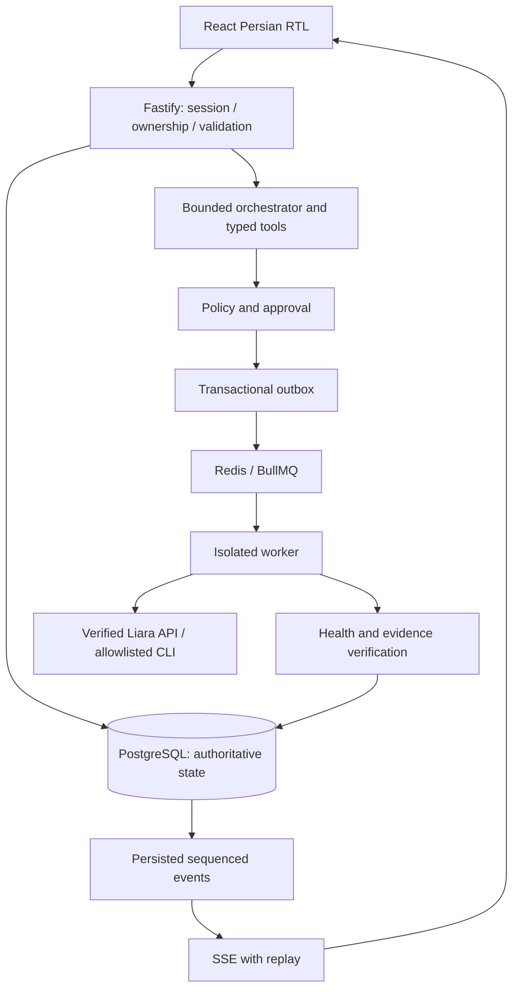

# معماری پیشنهادی

وضعیت: معماری هدف فاز ۱؛ auth/صف در فاز ۲، رابط در فاز ۳، اتصال خواندنی لیارا در فاز ۴ و دستیار/approval بررسی در فاز ۵ پیاده شده‌اند. انتشار و پایش خودکار هنوز طراحی‌اند؛ جزئیات اجرایی در انتهای سند است.

ساختار modular monolith با API و worker مستقل، بدون microservice اضافی. pnpm workspace با apps/web، apps/api، apps/worker و packages/shared، ai-agent، liara-adapter، github-adapter، security. کامپوننت‌های UI ابتدا داخل web نگهداری می‌شوند؛ استخراج بسته مستقل فقط در صورت استفاده مشترک. Turborepo اختیاری است.

Frontend: React، strict TypeScript، Vite، Tailwind، shadcn/Radix، Lucide، Motion، TanStack Query، Zustand محدود به UI، Router، RHF/Zod، Recharts، Sonner و date-fns. Backend: Node LTS، Fastify، Zod، Prisma/PostgreSQL، Redis/BullMQ، Pino و OpenAPI. مدل از طریق API سازگار OpenAI با تنظیمات سمت سرور قابل تعویض است.

## انتشار: قرارداد جریان کامل

۱. کاربر URL عمومی GitHub را وارد می‌کند؛ API فقط github.com و مسیر معتبر را می‌پذیرد و branch را به commit SHA تبدیل می‌کند.
۲. فایل‌های مجاز به‌صورت static و با سقف اندازه، تعداد، زمان و عمق بررسی می‌شوند؛ کد مخزن روی API اجرا نمی‌شود.
۳. تشخیص فریم‌ورک همراه نام فایل و شاهد برمی‌گردد. کمبود پورت یا تنظیمات به مرحله «نیازمند اطلاعات» می‌رود.
۴. طرح immutable شامل target، commit، منابع، تنظیمات مرجع، ریسک و نسخه سیاست تولید می‌شود. قیمت نامعتبر نمایش داده نمی‌شود.
۵. تأیید به هش طرح و secret-version reference متصل است. تغییر طرح تأیید تازه می‌خواهد.
۶. تراکنش DB، operation و outbox را ثبت می‌کند؛ dispatcher آن را به صف می‌فرستد. کلید idempotency و قفل برنامه از اجرای هم‌زمان جلوگیری می‌کنند.
۷. worker مجوز، انقضا و هش را مجدداً بررسی می‌کند. سورس از snapshot همان commit بسته‌بندی و بارگذاری می‌شود؛ سپس release ساخته می‌شود. ساخت کد نیازمند محیط جداست.
۸. رویدادهای واقعی با sequence ذخیره و SSE ارسال می‌شوند. refresh به همان operation بازمی‌گردد.
۹. وضعیت release، پاسخ HTTP، معیار پاسخ مورد انتظار و لاگ‌های مرتبط بررسی می‌شوند. ابهام به NEEDS_ATTENTION می‌رود؛ پاسخ ۲۰۰ به‌تنهایی موفقیت کامل نیست.

## تشخیص و بازیابی

انتخاب سرویس ← جمع‌آوری وضعیت، release، لاگ و HTTP با timestamp/source ← detectors قطعی ← تحلیل مدل با evidenceId ← نمایش واقعیت/فرضیه/کمبود شواهد ← اصلاح پیشنهادی ← تأیید مشخص ← اجرای adapter ← بررسی چندباره و مقایسه شواهد ← نتیجه یا ادامه بررسی. restart بدون تشخیص و تأیید خودکار اجرا نمی‌شود.

## ماشین وضعیت و دوام

CREATED → VALIDATING → PLANNED → AWAITING_APPROVAL → QUEUED → RUNNING → VERIFYING → SUCCEEDED / FAILED / NEEDS_ATTENTION.

CANCELLED و EXPIRED برای مراحل امن پیش از dispatch؛ لغو در حین اجرای provider تضمین نمی‌شود و UI باید آن را توضیح دهد. گذارها با compare-and-swap و تراکنش کنترل می‌شوند. صف at-least-once است؛ exactly-once ادعا نمی‌شود. پس از crash در درخواست مبهم، ابتدا وضعیت provider reconcile می‌شود؛ ایجاد منبع یا انتشار کورکورانه retry نمی‌شود.

## مرزهای داده

PostgreSQL منبع حقیقت است؛ Redis محل موقت صف. SSE از eventهای پایدار با Last-Event-ID و کنترل مالکیت replay می‌شود. Mode در تمام connection، project، operation، event و evidence وجود دارد؛ ارتباط متقاطع demo/live رد می‌شود. دمو fixture مشخص و بدون فراخوانی زیرساخت واقعی دارد.

نشست کاربر با cookie امن HttpOnly/SameSite و session پایدار مدیریت می‌شود. هیچ کلید provider یا مدل به مرورگر فرستاده نمی‌شود. خلاصه گفتگو فقط داده پاکسازی‌شده دارد. مدل تصمیم‌گیر مجوز نیست و تنها ابزار واقعاً پیاده‌شده ثبت می‌شود.

## پیاده‌سازی UI فاز ۳

مسیر عمومی `/demo/*` با WorkspaceShell و داده‌های ثابت Zod-validated مستقل از حساب کاربر کار می‌کند و درخواست اتصال/عملیات زیرساختی ندارد. مسیر `/workspace/*` نیازمند نشست است. حالت frontend برابر DEMO یا LOCAL است؛ LOCAL یعنی حساب شخصی بدون اتصال ابری و با schema فعلی فاز ۲ که mode رکوردهای آن DEMO است. این نام UI، حالت زیرساخت LIVE ایجاد نمی‌کند.

پروژه‌های دمو هرگز در جداول پروژه شخصی نوشته نمی‌شوند. پاسخ دستیار دمو محلی و rule-based است؛ به رجیستری ابزار یا orchestration واقعی وصل نیست. نمودارها و رویدادها timestamp/source مشخص نمونه دارند. رابط هیچ token ارائه‌دهنده‌ای دریافت نمی‌کند.

## وضعیت اجرایی فاز ۴

فاز ۴ اکنون packages/liara-adapter را برای خواندن GET از API رسمی، connection service را برای رمزنگاری/مالکیت/همگام‌سازی و صفحات خصوصی LIVE را برای داده واقعی دارد. دمو مستقل می‌ماند. قراردادها و محدودیت تأیید زنده در LIARA_INTEGRATION.md ثبت شده‌اند.

## وضعیت اجرایی فاز ۵

بسته ai-agent برای دو wire contract Responses/Chat و ابزارهای strict اضافه شد. AssistantService کنترل مالکیت، قفل پایدار، حداکثر دو فراخوانی مدل در پیام، طرح تغییرناپذیر و اجرای خواندنی پس از تأیید را انجام می‌دهد. گزارش ساختاریافته ارجاع شواهد را بررسی می‌کند. SSE و اجرای mutation در worker در فازهای بعد باقی‌اند.

## وضعیت اجرایی فاز ۶

DeploymentService برای طرح immutable و تصمیم اتمیک، packages/github-adapter برای تحلیل static commit/tree/blob، packages/deployment برای source archive/POST رسمی/health pinned و queue مستقل اضافه شدند. worker هر دو صف محلی و انتشار را dispatch می‌کند. رویدادهای انتشار پایدار و SSE خصوصی با replay هستند. مدل فقط ابزار ساخت طرح انتشار دارد و مجوز اجرا صادر نمی‌کند. provider مدل با server allowlist در هر گفتگو انتخاب می‌شود.
